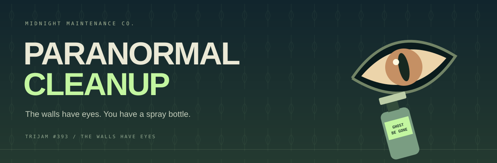
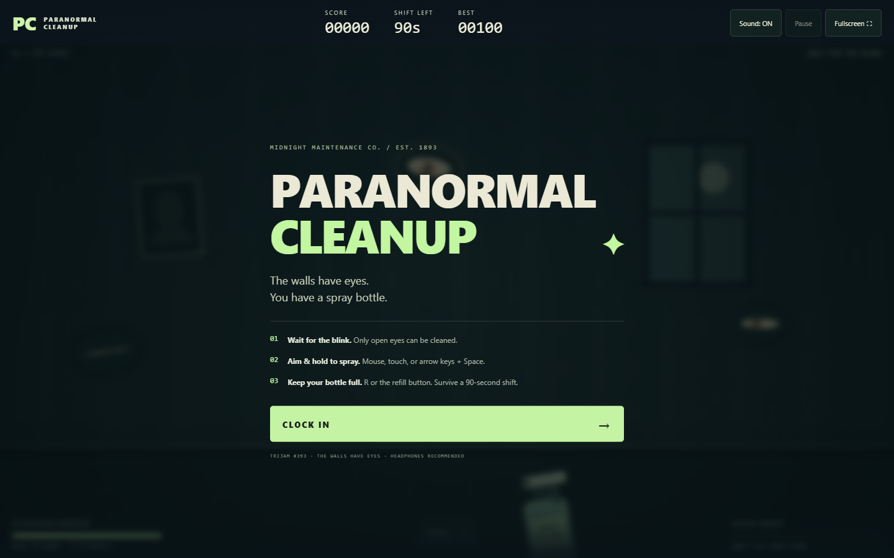
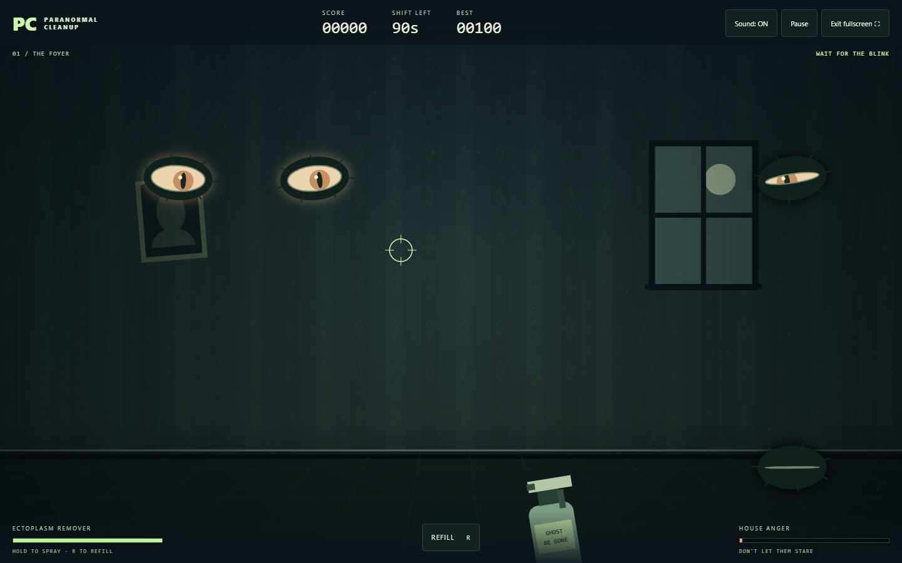

<div align="center">



**A midnight shift. A haunted house. One very underpaid cleaner.**


[The Jam](https://itch.io/jam/trijam-393) · [How to Play](#how-to-play) · [Run Locally](#run-locally) · [Credits](#credits)

</div>

## Your shift starts at midnight

Welcome to **Midnight Maintenance Co.** Your assignment sounds simple: clean the house before your shift ends. Unfortunately, the wallpaper is looking back.

**Paranormal Cleanup** is a compact reflex arcade made for **Trijam #393**, with the theme **“The Walls Have Eyes.”** Aim your ectoplasm remover at blinking wall eyes, spray while they are open, and keep the house from waking up. You have **90 seconds** to earn your paycheck.

## How to play

1. Select **Clock In**. The game requests fullscreen when your browser allows it.
2. Aim at an eye and **hold to spray while it is open**. Closed eyelids block your spray.
3. Press **R** or select **Refill** when your bottle runs low. Refilling takes **1.3 seconds**.
4. Clean eyes before their stares fill the **House Anger** meter.
5. Survive the full shift and chase a new personal best.

Each cleaned eye starts at **100 points**. Consecutive eye cleanups build a streak, adding **25 points per streak step**, up to **350 points per eye**. Spraying empty space or closed eyes breaks your streak. Cleaning an eye reduces house anger.

| Action | Mouse / keyboard | Touch |
| :--- | :--- | :--- |
| Aim | Move the mouse, arrow keys, or WASD | Drag on the room |
| Spray | Hold left mouse button or Space | Hold on an open eye |
| Refill | R or the Refill button | Tap Refill |
| Pause / resume | P or the Pause button | Tap Pause / Resume |
| Start / retry | Enter or Clock In | Tap Clock In |
| Fullscreen | Fullscreen button | Fullscreen button, where supported |
| Toggle audio | Sound button | Sound button |

> **Cleaner’s tip:** short, deliberate bursts beat panic spraying. Refill during a blink.

## A little haunted atmosphere

- Original illustrated room, crooked portrait, moonlit window, and animated wall eyes.
- Three escalating parts of your shift: **The Foyer → The Parlor → The Attic**.
- Spray particles, floating score popups, and synthesized sound effects.
- Full-viewport layout, automatic fullscreen request on Clock In, and a dedicated **Fullscreen** toggle.
- Controls and target positions adapt to portrait, landscape, small embeds, and large displays.
- Start, gameplay, and result screens fit one viewport with no internal scrolling.
- Mouse, keyboard, and touch controls.
- Automatic pause when the window loses focus.
- Local personal best, saved in your browser when storage is available.
- No game engine, dependencies, downloaded fonts, or external game assets.

## Screenshots





## Run locally

Open **`index.html`** in a modern browser. No installation or build step is required.

For a local web server, serve this folder with your preferred static server and open its local address. The game works offline; the README badges are decorative external images.

## Upload to itch.io

An upload-ready ZIP is supplied alongside the repository folder. It contains `index.html`, `style.css`, and `game.js` at the root.

1. Create an itch.io project and choose **HTML** as its kind of project.
2. Upload the ZIP and select **This file will be played in the browser**.
3. Select **Click to launch in fullscreen** in itch.io’s embed options.
4. If you prefer **Embed in page**, enable the fullscreen button and use **1280 × 800** as a starting size. The game also adapts to smaller embeds.
5. Include the controls, credits, and actual development time in the submission description.

Fullscreen availability depends on the browser and the embedding page’s permissions. Mobile browsers that do not support the Fullscreen API still receive a full-viewport layout.

## Quality checks

The responsive revision was checked in desktop Edge with automated viewport tests from **240 × 240** through **3840 × 2160**, including portrait and landscape mobile layouts. Fullscreen entry/exit, blocked fullscreen fallback, target placement, keyboard and pointer controls, touch cancellation, refilling, scoring, pause, victory, defeat, and retry were verified. Spray consumption was compared at 15, 30, 60, and 120 frames per second.

See [QA notes](QA.md) for the tested sizes and browser limitations.

## Project layout

```text
index.html       Game shell and accessible UI
style.css        Responsive layout and visual identity
game.js          Game loop, canvas artwork, input, audio, and scoring
docs/            README banner and real game screenshots
README.md        You are here
```

## Credits

**Project author:** [SouBeatrizKaroline](https://github.com/SouBeatrizKaroline)

Developed with assistance from **OpenAI Codex**. Room illustrations and effects are drawn directly with Canvas; audio is synthesized with the Web Audio API. The README banner is an original SVG. No third-party game assets are used.

**Jam:** [Trijam #393](https://itch.io/jam/trijam-393)  
**Theme:** [The Walls Have Eyes](https://trijam.rocknightstudios.com/poll/jam/393)

Development time must be reported from the actual work log when submitting. This project does not claim a verified three-hour development time.

---

<div align="center">

**Leave the house cleaner than you found it.**  
*Preferably with fewer eyes.*

</div>
